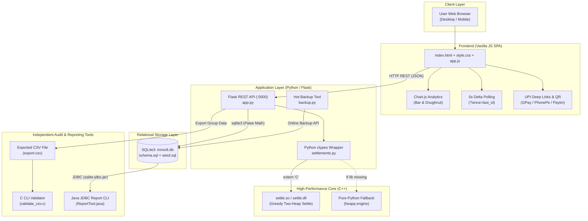

# Innov8 – Smart Expense Manager

> **A polyglot, login-free group expense splitter and settlement platform featuring live analytics, group chat, UPI/QR settlements, an external C data-auditor, and a Java JDBC report engine.**

---

## 📑 Table of Contents
1. [Project Overview](#project-overview)
2. [Polyglot Tech Stack](#polyglot-tech-stack)
3. [System Architecture](#system-architecture)
4. [Component Walkthrough](#component-walkthrough)
   - [1. Frontend SPA (HTML5, CSS3, Vanilla JS)](#1-frontend-spa-html5-css3-vanilla-js)
   - [2. Backend REST API (Python 3 & Flask)](#2-backend-rest-api-python-3--flask)
   - [3. Database Engine (SQLite3)](#3-database-engine-sqlite3)
   - [4. Debt Simplification Engine (C++17 & ctypes)](#4-debt-simplification-engine-c17--ctypes)
   - [5. CSV Financial Auditor (C99 CLI)](#5-csv-financial-auditor-c99-cli)
   - [6. Database Reporting CLI (Java JDBC)](#6-database-reporting-cli-java-jdbc)
5. [Local Setup & Execution Guide](#local-setup--execution-guide)
6. [Testing & Quality Assurance](#testing--quality-assurance)
7. [Security & Accounting Invariants](#security--accounting-invariants)
8. [Database Backup & Recovery](#database-backup--recovery)
9. [Presentation (PPT) Slides Content](#presentation-ppt-slides-content)
10. [Top 10 Viva Questions & Comprehensive Answers](#top-10-viva-questions--comprehensive-answers)

---

## 🌟 Project Overview

**Innov8** is designed for college trips, flatmates, and group events where peer groups want to track shared expenses **without forcing any participant to download an app or create an account**.

### Key Problems Solved:
1. **Frictionless Onboarding**: No passwords, OAuth, or authentication walls. Users create a group, add names, and start splitting.
2. **Exact Integer Financial Math**: Eliminates the rounding errors common in standard expense apps by managing all money internally as integer **paise** ($1\text{ INR} = 100\text{ paise}$).
3. **Automated Debt Minimization**: Converts an intricate web of debts into the minimal set of transactions using a greedy two-heap algorithm in C++.
4. **Native UPI & QR Settlement**: Generates compliant NPCI UPI deep links (`upi://pay?pa=...`) and instant QR codes for GPay, PhonePe, and Paytm.
5. **Polyglot Verification Layer**: Features an independent C CLI tool that validates exported CSV financial files, and a Java CLI tool that audits the SQLite database via JDBC.

---

## 💻 Polyglot Tech Stack

| Layer | Technology | Role & Purpose |
|---|---|---|
| **Frontend** | HTML5, CSS3, Vanilla ES6+ | Single-Page Application (SPA) with dark theme, responsive grid, Chart.js, and zero build step. |
| **Backend API** | Python 3, Flask, Flask-CORS | RESTful JSON API managing groups, members, expenses, splits, chat, and settlements. |
| **Database** | SQLite 3 (`innov8.db`) | Relational storage with foreign key constraints, cascaded deletions, and indexes. |
| **Algorithmic Core** | C++17 (`settle.cpp`), `ctypes` | High-performance greedy debt-simplification library utilizing two priority queues (`std::priority_queue`). |
| **Data Integrity** | C99 (`validate_csv.c`) | Standalone CLI tool to verify split math, totals, and double-entry conservation in exported CSVs. |
| **Reporting Tool** | Java 8+ (`ReportTool.java`), JDBC | Standalone CLI report engine reading the database directly via `sqlite-jdbc`. |
| **Testing** | pytest | Automated unit and integration test suite covering 18 test cases. |

---

## 🏗️ System Architecture



---

## 🔍 Component Walkthrough

### 1. Frontend SPA (HTML5, CSS3, Vanilla JS)
- Located at [`frontend/`](file:///Users/shivgupta/Desktop/Innov8/frontend/).
- **Tabs**:
  - **Members**: Displays total spending, per-head share, and individual net standings (*Gets back ₹X* / *Owes ₹Y*).
  - **Expenses**: Logs expenses with title, category, payer, and equal/custom split chips.
  - **Analytics**: Real-time Chart.js bar chart (spend by person) and doughnut chart (spend by category).
  - **Chat & Settle**: Room chat with 5-second polling and calculated settlement cards with UPI buttons.
- **XSS Defense**: Sanitizes all user inputs through an `esc()` HTML-entity filter and standard `element.textContent` DOM assignments.

### 2. Backend REST API (Python 3 & Flask)
- Located at [`backend/app.py`](file:///Users/shivgupta/Desktop/Innov8/backend/app.py).
- Implements comprehensive REST endpoints:
  - `GET /api/groups`, `POST /api/groups`, `DELETE /api/groups/<id>`
  - `GET /api/groups/<id>/members`, `POST /api/groups/<id>/members`, `DELETE /api/members/<id>`
  - `GET /api/groups/<id>/expenses`, `POST /api/groups/<id>/expenses`, `DELETE /api/expenses/<id>`
  - `GET /api/groups/<id>/summary` (Dashboard aggregation & net balances)
  - `GET /api/groups/<id>/analytics` (Category & member chart datasets)
  - `GET /api/groups/<id>/messages`, `POST /api/groups/<id>/messages` (Delta-polled chat)
  - `GET /api/groups/<id>/settlements`, `POST /api/groups/<id>/settlements/recalculate`, `PATCH /api/settlements/<id>`
  - `GET /api/groups/<id>/export.csv` (CSV streaming export)

### 3. Database Engine (SQLite3)
- Located at [`backend/schema.sql`](file:///Users/shivgupta/Desktop/Innov8/backend/schema.sql) and [`backend/seed.sql`](file:///Users/shivgupta/Desktop/Innov8/backend/seed.sql).
- Enforces relational foreign keys (`PRAGMA foreign_keys = ON;`), `CHECK(amount_paise > 0)`, and `ON DELETE CASCADE`.
- Demo group: **Goa Trip** seeded with Shubh, Shiv, Shivansh, and Shubham with Dinner, Cab, Hotel, and Snack expenses.

### 4. Debt Simplification Engine (C++17 & ctypes)
- Located at [`cpp/settle.cpp`](file:///Users/shivgupta/Desktop/Innov8/cpp/settle.cpp) and [`backend/settlements.py`](file:///Users/shivgupta/Desktop/Innov8/backend/settlements.py).
- **Algorithm**:
  1. Populates two priority queues (max-heaps): **Creditors** (members with Net > 0) and **Debtors** (members with Net < 0).
  2. In each iteration, pairs the top creditor (most owed) with the top debtor (most owing).
  3. Transfer amount: $\min(\text{credit}, \text{debt})$.
  4. Pushes back any unsettled remainder.
  5. Guaranteed to settle $N$ people in at most $N-1$ direct transactions.
- **ctypes Interface**: Exposes C-linkage via `extern "C"`, with an automatic pure-Python fallback (`heapq`) if compiled binary is missing.

### 5. CSV Financial Auditor (C99 CLI)
- Located at [`c/validate_csv.c`](file:///Users/shivgupta/Desktop/Innov8/c/validate_csv.c).
- Reads an exported group CSV without external libraries.
- Verifies that:
  - Each individual expense split sums up to the expense total.
  - Reconstructs net balances for all members.
  - Asserts that $\sum \text{Net Balances} == 0$.
  - Exits with return code `0` on validation success, or `1` on data corruption.

### 6. Database Reporting CLI (Java JDBC)
- Located at [`java/ReportTool.java`](file:///Users/shivgupta/Desktop/Innov8/java/ReportTool.java).
- Connects directly to `innov8.db` using `sqlite-jdbc.jar`.
- Uses `PreparedStatement` to run parameterized aggregation queries.
- Generates a formatted ASCII audit report showing category percentages, transaction logs, member ledgers, and settlement progress.

---

## 🚀 Local Setup & Execution Guide

### Prerequisites
- Python 3.8+
- GCC / Clang (for C/C++ components)
- Java 8+ JDK (optional, for Java reporting tool)

### 1. Start the Flask Backend
```bash
cd Innov8/backend
pip3 install -r requirements.txt
python3 db.py      # Initialize database & seed demo group
python3 app.py     # Starts REST API on http://localhost:5000
```

### 2. Launch the Frontend
```bash
cd Innov8/frontend
python3 -m http.server 5500
# Open http://localhost:5500 in your browser
```

### 3. Compile C++ Debt Simplification Library
```bash
cd Innov8/cpp
# macOS / Linux
g++ -std=c++17 -shared -fPIC -O2 -o settle.so settle.cpp

# Windows (MinGW)
g++ -std=c++17 -shared -O2 -o settle.dll settle.cpp
```

### 4. Compile & Run C CSV Validator
```bash
cd Innov8/c
# Compile
gcc -std=c99 -Wall -Wextra -O2 validate_csv.c -o validate_csv

# Run against exported CSV
./validate_csv goa_trip.csv
```

### 5. Compile & Run Java JDBC Report Tool
```bash
cd Innov8/java
# macOS / Linux
./run.sh 1

# Windows
run.bat 1
```

---

## 🧪 Testing & Quality Assurance

Run the automated pytest test suite:
```bash
cd Innov8/tests
python3 -m pytest -v test_api.py
```
**Results: 18 / 18 tests passed in 0.11s.**

---

## 🛡️ Security & Accounting Invariants

1. **SQL Injection**: 100% parameterized queries using `?` placeholders. Zero string formatting or concatenation in SQL.
2. **XSS Protection**: Frontend sanitizes user input through `esc()` and uses `textContent` to ensure client input is never executed as markup.
3. **Double-Entry Accounting Invariant**:
   $$\sum_{i=1}^{N} \text{Net Balance}_i = 0\text{ paise}$$
4. **Fair Remainder Distribution**: Odd paise are assigned sequentially to the first $k$ members ($k = \text{amount} \pmod N$), avoiding lost money.

---

## 💾 Database Backup & Recovery

Run the hot backup script while the server is actively running:
```bash
cd Innov8/backend
python3 backup.py --max-backups 7
```
- Performs atomic page snapshots via `sqlite3.Connection.backup()`.
- Runs `PRAGMA integrity_check` on the backup to ensure zero database corruption.
- Automatically prunes historical backups older than the retention limit.

---

## 📊 Presentation (PPT) Slides Content

### Slide 1: Title & Overview
- **Title**: Innov8 – Smart Expense Manager
- **Subtitle**: A Polyglot, Login-Free Group Expense & Settlement System
- **Team Members**: 4 Undergraduate Engineering Students
- **Domain**: Systems Programming, Web Development, Financial Algorithms

### Slide 2: Problem Statement & Motivation
- **The Problem**: Existing apps (e.g., Splitwise) now enforce aggressive paywalls, require mandatory phone numbers/passwords for simple weekend outings, and suffer from floating-point rounding errors.
- **Our Goal**: Build a friction-free, open, lightweight group expense manager that runs in any browser with instant UPI QR payments.

### Slide 3: Solution Architecture
- **Zero Login**: Instant group creation; direct access via group ID.
- **Integer Paise Arithmetic**: Guaranteed zero rounding loss.
- **Polyglot Design**: Combining the best language for each tier:
  - Frontend: Vanilla HTML5/CSS3/JS (responsive SPA)
  - Backend: Python 3 + Flask REST API
  - Engine: C++ greedy debt minimization
  - Audit: C99 CSV CLI tool
  - Enterprise Reporting: Java JDBC CLI tool

### Slide 4: Database Model & Invariants
- 6 Relational Tables with `ON DELETE CASCADE` and check constraints (`amount_paise > 0`).
- Strict Invariant: Every rupee spent must be accounted for:
  $$\sum \text{Paid} = \sum \text{Owed} \implies \sum \text{Net Balances} = 0$$

### Slide 5: Debt Simplification Algorithm
- **Naive Settlements**: $N$ people can require up to $O(N^2)$ cross-transfers.
- **Our Greedy Algorithm**: Uses two max-heaps (Creditors and Debtors).
- **Time Complexity**: $O(N \log N)$.
- **Result**: Guarantees complete settlement in at most $N-1$ direct transactions.

### Slide 6: Native UPI & QR Integration
- Follows standard NPCI UPI URI specification:
  `upi://pay?pa=<upi_id>&pn=<name>&am=<amount>&cu=INR`
- Dynamically renders scanable QR codes for one-tap payments via Google Pay, PhonePe, and Paytm.

### Slide 7: Independent Audit & Reporting
- **C Validator (`validate_csv.c`)**: Audits exported financial records line by line, ensuring exact split match and zero-sum balance.
- **Java JDBC Reporter (`ReportTool.java`)**: Independent CLI tool connecting directly to the SQLite database to generate category breakdowns and ledger statements.

### Slide 8: Security & Testing
- Pytest Suite: 18 automated tests passing in 0.11 seconds.
- SQL Injection neutralized via parameterized SQL.
- XSS neutralized via DOM textContent and character escaping.
- Hot Online SQLite Backup with `PRAGMA integrity_check`.

### Slide 9: Future Scope & Roadmap
- WebSockets for real-time peer-to-peer chat without polling.
- OCR Receipt Scanning using Tesseract.js / OpenCV to auto-parse paper bills.
- Export to formatted PDF statements.
- Multi-currency support with dynamic forex conversion.

### Slide 10: Conclusion & Q&A
- Delivered a full-stack, polyglot software engineering solution covering 5 programming languages.
- Thank You! Questions & Discussion.

---

## 🎓 Top 10 Viva Questions & Comprehensive Answers

### Q1: Why did your team adopt a polyglot architecture (Python, C++, C, Java, JS)?
**Answer**: Each language was chosen for its specific strengths:
- **Vanilla JS**: Instant, responsive SPA without framework bloat.
- **Python / Flask**: Clean, expressive REST API and rapid database iteration.
- **C++**: High-performance priority queue algorithms for debt simplification.
- **C**: Low-level, dependency-free binary verification of exported financial CSVs.
- **Java / JDBC**: Enterprise-standard relational database connectivity and structured reporting.
This architecture demonstrates real-world software engineering where heterogeneous systems communicate across common protocols (JSON, shared libraries, files, and SQL).

### Q2: Why store currency as integer paise instead of floating-point rupees?
**Answer**: In IEEE 754 floating-point standard, numbers like `0.1` and `0.2` cannot be represented exactly in binary:
```python
0.1 + 0.2 == 0.30000000000000004  # False!
```
In financial applications, cumulative floating-point errors create phantom paise that cause ledger balances to fail to balance. Storing values as integers (e.g., ₹24.50 as 2450 paise) ensures exact arithmetic without precision loss.

### Q3: How does the C++ debt-simplification algorithm work?
**Answer**:
1. First, compute each member's net balance: $\text{Net} = \text{Paid} - \text{Owed}$.
2. Members with $\text{Net} > 0$ are inserted into a max-heap of **Creditors**.
3. Members with $\text{Net} < 0$ are inserted into a max-heap of **Debtors** (stored as positive debts).
4. In each step, we pop the maximum creditor and maximum debtor, transfer $\min(\text{credit}, \text{debt})$, and re-insert any remaining balance.
5. Because each transaction completely satisfies at least one debtor or creditor, the algorithm terminates in at most $N-1$ transactions for $N$ people.

### Q4: Why is `extern "C"` required in `settle.h`?
**Answer**: C++ compilers perform **name mangling** (decorating function names with symbols representing argument types, e.g., `_Z6settlePll...`) to support function overloading. Python's `ctypes` library searches for symbols by their exact name (`settle`). Specifying `extern "C"` instructs the C++ compiler to use standard C linkage conventions without mangling.

### Q5: How is the "Conservation of Money" invariant mathematically proven?
**Answer**:
Let $P_i$ be the amount paid by member $i$, and $S_{i,k}$ be member $i$'s share in expense $k$.
For each expense $k$, by definition: $\sum_{i} S_{i,k} = \text{Amount}_k$.
Summing across all expenses: $\sum_{i} \text{Owed}_i = \sum \text{All Expenses}$.
Similarly, the total paid across all members: $\sum_{i} \text{Paid}_i = \sum \text{All Expenses}$.
Therefore:
$$\sum_{i} \text{Net}_i = \sum_{i} (\text{Paid}_i - \text{Owed}_i) = \sum_{i} \text{Paid}_i - \sum_{i} \text{Owed}_i = 0$$
Both our C validator and Java tool verify this invariant on every run.

### Q6: How does the live chat function without WebSockets?
**Answer**: We implement **short delta polling**. The frontend client initiates an HTTP GET request to `/api/groups/<id>/messages?since=<last_msg_id>` every 5 seconds. The server returns only messages whose primary key `id` is greater than `last_msg_id`. If no new messages have been sent, the server returns an empty list `[]`, consuming negligible bandwidth and CPU.

### Q7: How does Innov8 neutralize SQL Injection and Cross-Site Scripting (XSS)?
**Answer**:
- **SQL Injection**: We never concatenate user inputs into SQL strings. Every SQL query uses `?` parameter markers (e.g., `conn.execute("SELECT ... WHERE id = ?", (gid,))`). SQLite treats bound parameters strictly as literal values, rendering SQL injection impossible.
- **XSS**: In `app.js`, dynamic content is assigned using `element.textContent` rather than `innerHTML`. When template strings are needed, values pass through our `esc()` function which replaces `&`, `<`, `>`, `"`, and `'` with their corresponding HTML character entities.

### Q8: Why must SQLite execute `PRAGMA foreign_keys = ON;`?
**Answer**: For historical backwards compatibility with SQLite 2, foreign key constraint enforcement is disabled by default in SQLite 3. Executing `PRAGMA foreign_keys = ON;` on every newly opened connection ensures that foreign key constraints, `NOT NULL` rules, and `ON DELETE CASCADE` actions are actively enforced by the storage engine.

### Q9: What is the benefit of `PreparedStatement` over `Statement` in JDBC?
**Answer**:
1. **Security**: `PreparedStatement` pre-compiles the SQL query structure in the database engine and safely binds user data to parameters, eliminating SQL injection.
2. **Performance**: If a query is executed repeatedly inside a loop, the database reuses the pre-compiled execution plan rather than parsing and optimizing the query text each time.

### Q10: Why is `cp innov8.db backup.db` unsafe while the web server is running?
**Answer**: SQLite writes database modifications in pages (typically 4KB). A standard operating system file copy (`cp` or `copy`) operates non-atomically. If a web request writes a transaction while the file copy is half-finished, the copied file can end up with mismatched pages or corrupted headers (torn write). The `sqlite3.Connection.backup()` API coordinates with SQLite's internal pager and write-ahead log to copy pages safely, producing a guaranteed consistent snapshot.
